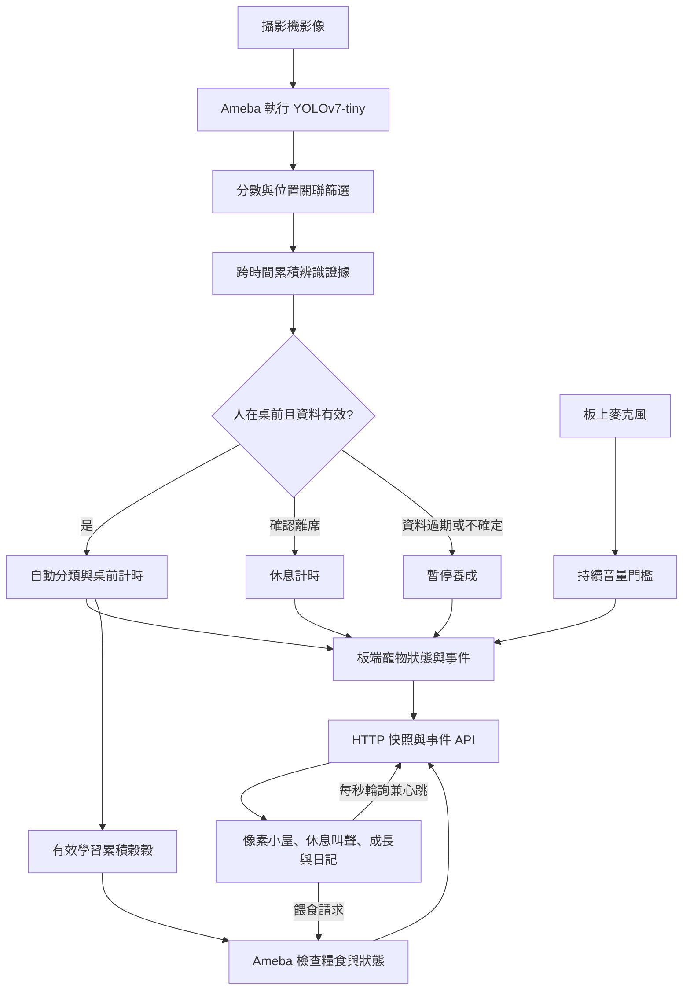

# 啾啾的小屋：技術與開發說明

簡短介紹與使用步驟見 [README](README.md)。本文件保留完整規則、開發流程與測試細節。

「讓 Ameba 看懂生活——影像辨識創意實作」第二週原型。AMB82-MINI 在板上辨識人、書本、手機及電腦相關物件，自動記錄桌前活動；同一個 Wi-Fi 的手機或電腦開啟 Ameba 提供的網頁，即可看到電子寵物、休息提醒及事件紀錄。

活動全自動判斷，沒有手動讀書模式或模擬辨識按鈕。網頁不透過 USB 收資料；USB 用於首次燒錄及供電。此專案沒有加入 OTA。

GitHub：[ruby0226/ameba-study-buddy](https://github.com/ruby0226/ameba-study-buddy)。第二週操作影片尚待錄製與上傳。

## 目前進度

2026-10-18：網頁改為「啾啾的小屋」，加入像素房間、自由走動、學習穀穀獎勵、餵食及五階段成長。獎勵與餵食由 Ameba 記錄；網頁只顯示陪伴資訊，移除分數、校正面板、原始資料及 CSV 匯出。網頁自動測試、桌面／手機瀏覽器測試及 AMB82-MINI 編譯已通過。保留兩階段休息叫聲與環境音量提示，沒有拍手互動。

本次展示版已燒錄成功，實機回傳新版網頁（HTTP 200）及 PET／CARE 資料，確認提醒 60 秒、休息 10 秒、衰減 30 秒、獎勵 15 秒。原始碼預設仍是一般版 `PET_DEMO=0`；展示韌體另以編譯旗標產生。這次確認的是啟動、連線與設定，書本觸發獎勵、餵食、叫聲與休息的完整實機流程仍待錄影與紀錄。

以下項目尚未完成：系統化的書本／手機辨識率、環境噪音提示誤判率、長時間 Wi-Fi 穩定性及新版操作影片。自動測試使用模擬資料，不代表真實攝影機準確度。

最新調整：讀書、電腦、手機各有不同場景與小雞動作；手機穩定出現時，板端暫停穀穀累積並保留進度，在座與休息提醒繼續。新增依類別與框位置配對的物件 ID 追蹤。2026-10-18 本次更新已完成展示版燒錄，實機 HTTP 200 回傳新版三種場景與展示設定；實際物件切換及追蹤效果仍待攝影機測試。

## 硬體與軟體

| 項目 | 說明 |
| --- | --- |
| 開發板 | Realtek Ameba AMB82-MINI、攝影機、板上麥克風 |
| 電源與首次燒錄 | 可傳資料的 USB 線；日常可接充電器或行動電源 |
| 網路 | 板子與瀏覽器所在裝置可互通的區域網路 |
| 顯示 | Chrome／Edge；RTSP 畫面另外用 VLC 查看 |
| 開發環境 | Arduino IDE 2.x 或 Arduino CLI，Realtek AmebaPro2 SDK |
| 本機驗證 SDK | `4.1.1-build20260922`；FQBN：`realtek:AmebaPro2:Ameba_AMB82-MINI` |
| 開發用 Node.js | 建議 Node.js 22 以上，打包與網頁測試只用內建模組，不需 npm install |
| 額外硬體 | 不強制；RGB LED 預設未啟用，沒有蜂鳴器或喇叭輸出模組 |

板端模型為 SDK 內建 `DEFAULT_YOLOV7TINY`，沒有自行訓練模型。推論輸入設定為 576 × 320、10 FPS；此處是影像設定，不是量測出的模型 FPS。RTSP 使用 FHD H.264。

## 運作流程



Ameba 負責推論、判斷、計時、事件與糧食存量；瀏覽器負責呈現、合成叫聲與送出餵食。影像不送到雲端辨識。RTSP 與網頁狀態是兩條不同資料路徑；瀏覽器頁面沒有內嵌即時攝影機影片。

## 相較原始物件偵測範例的延伸

以官方 `ObjectDetectionLoop`／`ObjectDetectionCallback` 的物件偵測、框選與 RTSP 功能為基準，新增下列應用層功能。課堂實際使用的原始範例版本仍需補註；若該版本已包含某項功能，不能把保留部分列為新增。

第一週提交 [`bcc7f0c`](https://github.com/ruby0226/ameba-study-buddy/commit/bcc7f0c4f0a38d435a810db30f16ab84891ae86a) 已有時間證據、位置關聯與基本活動計時。第二週新增重點是 Wi-Fi 直接提供網頁、板端休息養成、寵物事件紀錄、網頁心跳保護及麥克風互動；不能把第一週已完成功能稱為本週才新增。

| 延伸 | 本專案行為 | 主要檔案 |
| --- | --- | --- |
| 多次一致才成立 | 最近五個秒區間累積新推論，排除瞬間閃爍 | `DetectionEvidence.h` |
| 多類別位置關聯 | 書／手機弱候選輔助、相似物件衝突排除、鍵盤＋滑鼠電腦線索 | `SceneRelations.h` |
| 物件跨幀追蹤 | 同類別按框重疊與距離配對 ID，每個物件獨立累積確認；漏判短暫保留、逾時移除 | `ObjectTracks.h` |
| 辨識結果帶動反應 | 自動讀書、電腦、在桌前、離席與無法確認狀態 | `.ino`、`web/pet_test.html` |
| 休息與寵物養成 | 分階段提醒、活力、休息恢復、死亡重生及成長 | `PetLife.h` |
| Wi-Fi 網頁整合 | 板端提供網頁、輪詢 API、心跳及短期事件補收 | `PetNetwork.h` |
| 計數與日記 | 板端累積活動與事件，網頁以最近五則小屋日記呈現 | `.ino`、網頁 |
| 學習獎勵與餵食 | 板端累積穀穀、驗證餵食與防重複扣款，網頁呈現五階段成長 | `PetCare.h`、`PetNetwork.h`、網頁 |
| 異常處理 | 推論過期、人物不明或心跳中斷時暫停養成 | `.ino`、`PetLife.h` |
| 麥克風互動 | 持續音量事件與網頁環境提示 | `PetSound.h` |

## 資料夾

```text
Day3_StudyBuddy_Verify/
  Day3_StudyBuddy_Verify.ino    主程式
  DetectionEvidence.h         跨時間辨識證據
  SceneRelations.h            物件位置與衝突判斷
  ObjectTracks.h              物件 ID、框位置配對與失聯清除
  StudyActivity.h             活動優先順序與獎勵資格
  PetLife.h                   寵物與休息規則
  PetCare.h                   學習獎勵、糧食與餵食規則
  PetSound.h                  麥克風音量與吵雜判斷
  PetNetwork.h                HTTP 伺服器、心跳、事件暫存
  PetWebPage.h                已打包網頁，直接編譯可用
  WiFiSecrets.example.h       空白 Wi-Fi 設定範本
web/pet_test.html             網頁原始檔
scripts/embed-web.cjs         更新韌體內的網頁
tests/                       網頁、規則及瀏覽器測試
README.md                    安裝與使用說明
第二週_原型操作與測試.md       詳細操作規則
第二週_改進與繳交檢查.md       測試目標及繳交清單
第二週_實測紀錄.csv            尚待填入的實測表
第二週_拍攝與補件指南.md       110 秒拍攝腳本與待提供資料
```

`WiFiSecrets.h`、`.build/`、私人影片與作業 Word 留在本機，不上傳。程式倉庫不需要 Word 或影片才能運作。

## 安裝、設定與首次燒錄

### 1. 安裝開發板套件

在 Arduino IDE 的「偏好設定 → 額外的開發板管理員網址」加入官方 AmebaPro2 套件索引，再於開發板管理員安裝套件，選擇 `AmebaPro2 ARM (32-bits) Boards → AMB82-MINI`。官方 stable 索引：

```text
https://github.com/Ameba-AIoT/ameba-arduino-pro2/raw/main/Arduino_package/package_realtek_amebapro2_index.json
```

本專案驗證環境使用上述 `4.1.1-build20260922`，官方另提供 dev 套件索引；套件可用版本可能不同。若使用其他版本，請重新編譯和實測，勿把版本差異當成已驗證。安裝步驟與索引來源見 [官方 Getting Started](https://github.com/Ameba-AIoT/ameba-arduino-doc/blob/main/source/ameba_pro2/amb82-mini/Getting_Started/Getting%20Started%20with%20Ameba.rst)。

### 2. 填寫本機 Wi-Fi 設定

將 `Day3_StudyBuddy_Verify/WiFiSecrets.example.h` 複製成同資料夾的 `WiFiSecrets.h`，修改兩個字串：

```cpp
#pragma once
#define WIFI_SSID "你的Wi-Fi名稱"
#define WIFI_PASSWORD "你的Wi-Fi密碼"
```

不要修改範本中的預設字串，也不要提交 `WiFiSecrets.h`。設定檔不存在時出現 `WiFiSecrets.h: No such file or directory`，表示還沒完成這個步驟。本機原有設定已另外保留。

### 3. 開啟與編譯

開啟 `Day3_StudyBuddy_Verify/Day3_StudyBuddy_Verify.ino`，保留同資料夾所有標頭。`PetWebPage.h` 已放在專案裡，沒有改網頁時可直接按 Arduino IDE 的「驗證」。

若已安裝 Arduino CLI，也可在專案根目錄執行：

```text
arduino-cli compile --fqbn realtek:AmebaPro2:Ameba_AMB82-MINI --build-path .build/amb82 Day3_StudyBuddy_Verify
```

### 4. 燒錄

接上 USB 資料線，選擇實際出現的序列埠。若工具不能自動進入燒錄模式：按住 BOOT，按一下並放開 RST，最後放開 BOOT，再執行上傳。先關閉占用序列埠的監控視窗。

本專案已使用下列 CLI 方式燒錄過；`COM3` 只是例子，請換成自己的連接埠：

```text
arduino-cli upload --fqbn realtek:AmebaPro2:Ameba_AMB82-MINI --port COM3 --input-file .build/amb82/flash_ntz.bin Day3_StudyBuddy_Verify
```

確認輸出為 `upload success`。此 SDK 的燒錄失敗可能仍以成功程序代碼結束，因此不能只看 exit code。完成後單按 RST 啟動程式，這次不要按 BOOT。

### 5. 開啟網頁

序列埠監控設為 115200 baud，找到 `Pet web: http://<IP>/`。也可從路由器的裝置清單，或 VLC 畫面上的 `WEB:` 取得 IP。

手機／電腦連到可與板子互通的 Wi-Fi，在瀏覽器開啟 `http://<IP>/`，按「開始陪伴」。例如板子分到 `192.168.1.100`，就開 `http://192.168.1.100/`；這個 IP 只是範例。右上角設定可切換提醒聲音或暫停陪伴。

按下連線會嘗試啟用瀏覽器音效。若靜音或音效被阻擋，文字提醒仍有效。保持網頁在前景；背景分頁節流可能造成心跳逾時。日常使用可將板子改由充電器供電，IP 可能因重新連線而改變。

從本機開 `web/pet_test.html` 時，它會引導前往板子網址；不要用 GitHub Pages 代替板端網頁。HTTP API 與頁面採同來源，沒有跨來源存取設定，也沒有外網登入服務。

## 活動判斷與固定擺放

建議單人、固定鏡頭與光源，畫面包含肩膀、上半身與桌面。鏡頭距離臉約 60～80 cm，向下俯約 30°，以 25～35°作為起始調整範圍。書面可先用閱讀架維持與桌面 30～45°；書寬至少約占畫面 1/4，手機長邊至少約占畫面高度 1/5。這些是待實測的擺放建議，網頁不會自動量角度。

書、筆電、鍵盤、滑鼠的中心需在青框內：左右 10～90%、上下 38～98%。手機可在青框內或靠近人的身體。人與桌子的判斷使用全畫面。

| 訊號 | 規則 |
| --- | --- |
| 模型最低候選分數 | 25 分 |
| 一般應用門檻 | 人 50，書與手機 30，其餘關聯類別 40 |
| 書／手機 25～29 分 | 必須另通過同幀位置關聯；沒有候選就不推測存在 |
| 物品穩定 | 至少 3 次命中、跨 2 個秒區間、首末相隔至少 1 秒；窗口比例書 15%、手機 25%、電腦 40% |
| 短暫漏判 | 最後命中後最多保留 3 秒；推論超過 2 秒未更新則清除 |
| 在座／離席 | 穩定在座約 3 秒才成立；約 10 秒確認離席 |

人物確認在座後，優先順序為：手機穩定出現 → `PHONE`；否則有書 → `STUDYING`；否則有筆電或鍵盤＋滑鼠線索 → `COMPUTER`；皆無則為 `PRESENT`。書與電腦同時成立採讀書優先，避免背景電腦使讀書失去反應。確認離席為 `AWAY`，資料不足或過期為 `UNSURE`。

| 活動 | 小屋反應 | 穀穀時間 |
| --- | --- | --- |
| 讀書 | 綠色讀書提示、大型翻頁書本、小雞讀書動作 | 累積 |
| 電腦 | 藍色電腦提示、螢幕游標、小雞打字動作 | 累積 |
| 手機出現 | 橘色提示、手機與暫停圖示、小雞等待；明示保留的剩餘時間 | 暫停，進度保留 |
| 單純在座／離席／無法確認 | 準備／休息／暫停提示 | 不累積 |

`PHONE` 代表有效範圍內有穩定手機目標，不等於「正在滑手機」。目前沒有手部模型；手機放在桌上也可能觸發。手機出現不額外扣活力、清空糧食或取消餵食，只暫停學習糧食獎勵；久坐計時和兩階段提醒照常運作。移走手機，最後命中超過 3 秒後解除，再依書／電腦情境繼續累積，不補算暫停時間。

### 跨幀追蹤的範圍

`ObjectTracks.h` 對書、手機、筆電、鍵盤和滑鼠保留最多 12 條軌跡，以類別、大小比例、框重疊與中心距離進行一對一配對。同一物件的 ID 與確認證據跨幀保留；不同位置的新目標需重新確認，不能把不同物件的零星命中湊成穩定。

在推論持續更新的情況下，短暫漏判最多保留最後一次實際命中後 3 秒，漏判不會延長期限。模型超過 2 秒未產生新結果，直接清除追蹤；失聯清除後重現會取得新 ID 並重新確認。RTSP 標籤顯示 `track`；暫時保留的最後位置顯示黃色框與 `hold`，不是新的偵測框。

這是「辨識結果關聯追蹤」，仍持續執行 YOLO；沒有新增光流、外觀特徵或獨立影像追蹤器，也不會降低推論頻率。完全遮擋、快速位移或相似物件交錯仍可能丟失或交換 ID，必須實測。真正只在初始化時分類、之後以影像更新位置，需要另外接入追蹤器並評估板端效能；影像追蹤仍要讀取後續影格，見 [OpenCV Tracker 介面](https://docs.opencv.org/4.13.0/d0/d0a/classcv_1_1Tracker.html)。本專案未依賴 OpenCV。

模型使用 person、book、cell phone、laptop、diningtable、keyboard、mouse、remote。紙、筆不是本版獨立辨識類別；沒有手部、抬頭或低頭模型。更完整的關聯規則見 [辨識優化與固定擺放](辨識優化與固定擺放.md)，該文件保留早期驗證紀錄；目前連線方式以本 README 為準。

## 小雞養成與叫聲

| 行為 | 一般設定 `PET_DEMO=0` | 展示設定 `PET_DEMO=1` |
| --- | --- | --- |
| 首次休息提醒 | 在座 25 分鐘 | 在座 60 秒 |
| 持續久坐第二次提醒 | 在座約 30 分鐘，活力降至 50 | 在座約 75 秒 |
| 活力歸零 | 在座約 35 分鐘 | 在座約 90 秒 |
| 有效休息 | 確認離席後連續 5 分鐘 | 確認離席後連續 10 秒 |
| 穀穀獎勵 | 有效讀書／電腦學習累積 5 分鐘獲得 1 份 | 累積 15 秒獲得 1 份 |
| 成長點數 | 餵食 +1；完整一輪學習與休息 +2 | 同左 |

這是遊戲參數，不是健康診斷或人體上限。在座、讀書、電腦情境都計入本輪時間，避免書本漏判造成不提醒。首次提醒是一組三聲短叫聲，第二次是一組兩聲短叫聲；每階段只播一次，死亡不額外叫。沒有拍手互動。重連同步不補播舊提醒。

短暫離席不重設本輪時間。完成有效休息會恢復活力；本輪達到提醒門檻再完成休息才獲得 +2 成長。死亡後完成休息會重生為蛋、代數加一，回座再孵化。原有桌前活動總時間不因死亡重設。

### 穀穀、餵食與像素小屋

- `STUDYING` 或 `COMPUTER` 且養成未暫停、未死亡時才累積穀穀；手機、單純坐著、離席或資料失效不會獲得獎勵。短暫暫停保留未滿一份的進度，不補算中斷時間。
- 糧倉最多 99 份，滿倉時不儲存額外獎勵。沒有免費起始糧食。
- 回到桌前、資料有效且有糧食才能餵。每次扣 1 份、成長 +1，板端至少間隔 4 秒；網頁讓啄食動畫結束後才開放再餵。餵食不補活力、不清除久坐時間，也不會讓死亡小雞復活。
- 成長依當代餵食次數＋完整學習休息輪數 ×2：孵化成小絨球；3 點成為小探險家、8 點成為陪讀夥伴、16 點成為小屋守護者。重生重設成長與未滿一份的獎勵進度，剩餘穀穀保留。
- 小雞在房間與頁面活動區走動，支援走路、讀書、啄食、跳躍、眨眼、打盹、疲倦與蛋搖晃。點小雞可以摸摸，只播放互動動畫，不改學習判斷或成長點數。系統設定減少動態效果時，停止走動與動畫。
- 房間、圖示與小雞均為內嵌像素 SVG，沒有外部圖片、字型或套件下載。手機版會調整卡片排列。

錄影要加速時，在主程式將 `#define PET_DEMO 0` 改為 `1`，重新編譯燒錄；網頁會顯示展示設定。這仍依實際辨識運作，不是模擬活動。

本次 SDK 的 `compiler.cpp.extra_flags` 未用於 C++ 編譯配方。若希望保留原始碼一般版預設，可使用以下展示版指令，保留原有板型旗標並額外定義 PET_DEMO：

```text
arduino-cli compile --fqbn realtek:AmebaPro2:Ameba_AMB82-MINI --build-property "build.extra_flags=-DARDUINO_SDK -DARDUINO_AMBPRO2 -DCORE_RTL8735B -DBOARD_AMB82_MINI {build.usb_flags} {build.menu_flags} -DPET_DEMO=1" --build-path .build/amb82-demo Day3_StudyBuddy_Verify
arduino-cli upload --fqbn realtek:AmebaPro2:Ameba_AMB82-MINI --port COM3 --input-file .build/amb82-demo/flash_ntz.bin Day3_StudyBuddy_Verify
```

錄影後恢復一般版：重新編譯不帶上述展示旗標的 `.build/amb82`，再用該目錄的 `flash_ntz.bin` 燒錄。拍攝安排見 [第二週拍攝與補件指南](第二週_拍攝與補件指南.md)。

## 麥克風互動

`PetSound.h` 每約 20 ms 讀取音量；預設持續音量門檻為 3000，是振幅值，不能當分貝。最近五秒有三秒偏高才進入環境吵雜，降至一秒或以下才解除。

麥克風只產生 NOISY／QUIET 狀態事件，不產生拍手事件，也不因環境聲播放音效或跳躍。這不是聲音分類模型；打字、說話或喇叭聲都可能提高振幅，需要依環境校正門檻。

## 連線、暫停與儲存限制

- 網頁每秒輪詢一次；Ameba 超過 3 秒未收到心跳，暫停寵物養成。
- 推論超過 2 秒未更新、人物狀態不明或養成迴圈停頓超過 1.5 秒，也暫停養成。
- 暫停不扣活力、不增加本輪在座時間、不當作休息，未完成的休息進度歸零。
- 活動總時間與寵物養成是不同計時器；前者仍可在辨識有效時繼續累計，後者依賴網頁心跳。
- 養成與計數在 RAM，板子斷電或 RST 會重設，尚無 SD 卡存檔。
- 板端保留最近 32 筆事件。網頁自動重試可補收短暫漏掉的事件；手動重新連線從目前開始。
- 小屋日記顯示本次開頁的最近五則生活事件，重新整理會清空日記；糧食、當代餵食次數和成長依板端資料恢復。日記不是每輪學習摘要，尚無跨斷電保存。
- 網頁已移除校正、技術數值與 CSV 匯出；工程驗證仍可讀序列埠的 CSV／STATE／PET 資料。
- 任一分頁送心跳都會維持養成，展示時建議只開一個主頁。

## 網路介面與資料格式

| 請求 | 行為 |
| --- | --- |
| `GET /` 或 `GET /pet_test.html` | 取得內嵌網頁 |
| `POST /api/poll?after=-1` | 首次同步；需 `X-StudyBuddy: 1` 標頭 |
| `POST /api/poll?after=<event_id>` | 取得快照與該事件編號之後仍在暫存的事件；同時更新心跳 |
| `POST /api/feed?boot=<boot_tag>&revision=<revision>` | 需 `X-StudyBuddy: 1`；驗證目前開機、版本、心跳、在座、糧食與冷卻，成功 200，狀態不符 409，回傳 CARE |

回應是 UTF-8 純文字，每行一筆：

```text
NET,snapshot_sequence,last_event_id,board_ms
CSV,...
STATE,t_s,state,desk_s,study_s,computer_s,mode,away_count,last_away_s,head,headdown_s,remind,phone_present,phone_near_person,mic_level,mic_peak,noisy
PET,t_ms,phase,energy,work_s,rest_s,cycles,rests,generation,reminders,paused,remind_goal_s,rest_goal_s,decay_s,demo,started
CARE,boot_tag,revision,generation,food,feeds,learned_s,next_reward_s,reward_goal_s,last_feed_ms,can_feed
EVENT,t_ms,event_id,event_name
```

CSV 為 36 欄；新版 STATE 為 17 欄，最後三欄是麥克風資訊。PET 為 16 欄，CARE 為 11 欄。時間為開機後秒數或毫秒，非日曆時間。麥克風沒有資料時音量為 -1；人臉舊欄位保留停用值。事件種類為 WELCOME、LEAVE、REMIND、WEAK、DIED、RESTED、REBORN、NOISY、QUIET、REWARD。

CARE 每次輪詢都更新，即使辨識快照序號不變也能取回最新餵食結果。餵食採版本檢查，同一版本只扣一次；回應中斷時網頁只重新查詢，不自動重送餵食。這是區域網路原型，沒有帳號或登入驗證，boot_tag 不是安全憑證。

網頁用 NET 序號去除重複快照，事件以編號去重。暫存溢出時回傳 `NOTICE,EVENT_GAP`。網頁 HTTP 請求逾 2 秒取消後重試；板端 Wi-Fi 斷線約每 10 秒嘗試重連，IP 改變需重新開網址。

## 修改網頁

只改 `web/pet_test.html` 不會更新板子內的頁面。修改後執行：

```text
node scripts/embed-web.cjs
node scripts/embed-web.cjs --check
```

再編譯、燒錄並重新整理瀏覽器。`PetWebPage.h` 是產生檔，請勿直接改它。

## VS Code 的 include 紅線

若 Arduino 編譯正常，但 VS Code 將 WiFi.h、StreamIO.h 等標紅，先檢查 C/C++ IntelliSense 是否有設定 SDK 路徑。本專案的標頭由 Ameba SDK 提供，不需另裝 ESP32 或其他版本的 WiFi 函式庫。

安裝 Microsoft C/C++ 擴充功能後，先依前述步驟編譯至 `.build/amb82`，再執行：

```text
node scripts/configure-vscode.cjs
```

工具會讀取實際 compile_commands.json，產生本機 `.vscode/c_cpp_properties.json` 與 `.ino` 的 C++ 檔案關聯，設定 ARM 編譯器、標頭路徑、巨集與 Arduino.h。這些含本機路徑的設定不提交 GitHub；換電腦或 SDK 版本後重新產生。若紅線未更新，執行「C/C++: Reset IntelliSense Database」或「Developer: Reload Window」。設定方法參考 [Microsoft C/C++ 文件](https://code.visualstudio.com/docs/cpp/customize-cpp-settings)。

## 自動測試與實機驗收

在根目錄執行網頁測試：

```text
node tests/pet_page.test.cjs
node scripts/embed-web.cjs --check
```

使用 C++14 編譯器檢查規則；測試使用編譯期斷言，無需執行板端程式。先建立 `.build` 資料夾，再執行：

```text
g++ -std=c++14 -Wall -Wextra -pedantic -c tests/pet_life.test.cpp -o .build/pet_life.test.o
g++ -std=c++14 -Wall -Wextra -pedantic -c tests/pet_care.test.cpp -o .build/pet_care.test.o
g++ -std=c++14 -Wall -Wextra -pedantic -c tests/object_tracks.test.cpp -o .build/object_tracks.test.o
g++ -std=c++14 -Wall -Wextra -pedantic -c tests/scene_relations.test.cpp -o .build/scene_relations.test.o
```

可用 SDK 的 `arm-none-eabi-g++` 取代 g++。`tests/network_browser.test.cjs` 另以本機 HTTP 伺服器和無視窗 Chrome 驗證輪詢、餵食與連點保護、小雞走動、減少動態效果、設定視窗鍵盤操作、斷線及手機／桌面版面：

```text
node tests/network_browser.test.cjs
```

瀏覽器測試目前使用 Windows Chrome 預設路徑 `C:/Program Files/Google/Chrome/Application/chrome.exe`；其他安裝位置需調整該測試的執行檔路徑。結果與截圖寫入 `.build/`。

必須另外完成攝影機、麥克風與實際 Wi-Fi 測試。條件、操作及通過標準見 [第二週改進與繳交檢查](第二週_改進與繳交檢查.md)，將實測寫入 [第二週實測紀錄](第二週_實測紀錄.csv)。目前表格未填結果，不代表測試已通過。

## 常見問題

| 問題 | 檢查方式 |
| --- | --- |
| 燒錄顯示 ping fail／upload fail | 確認 BOOT／RST 順序、實際 COM 埠、資料線及序列埠未被占用 |
| 編譯找不到 WiFiSecrets.h | 先複製設定範本並填入本機 Wi-Fi |
| 網頁開不起來 | 確認板子已啟動、實際 IP、同網路且無訪客裝置隔離；使用 http 而非 https |
| 開得到網頁但沒更新 | 按「開始陪伴」，檢查板端推論有無更新；HTTP 成功不代表影像有效 |
| 沒有叫聲 | 點擊連線啟用音效、確認未靜音；首次同步或重連不會補播舊提醒 |
| 書／手機辨識忽有忽無 | 固定光線、角度、大小及青框位置，查看候選分數與命中比例，勿把分數當準確率 |
| 環境提示過於敏感 | 查看音量與尖峰值，調整 MIC_NOISE_LEVEL，再測試安靜、打字與持續說話 |
| 關頁面後停止養成 | 目前設計需要網頁心跳，屬於已知規則 |
| 網頁還是舊內容 | 重新產生 PetWebPage.h、編譯、燒錄及整理頁面 |

## 來源與自行修改

參考 [Realtek AmebaPro2 SDK](https://github.com/Ameba-AIoT/ameba-arduino-pro2)、[官方物件偵測說明](https://github.com/Ameba-AIoT/ameba-arduino-doc/blob/main/source/ameba_pro2/amb82-mini/Example_Guides/Neural%20Network/Object%20Detection.rst)、[HTTP 伺服器範例](https://ameba-doc-arduino-sdk.readthedocs-hosted.com/en/latest/ameba_pro2/amb82-mini/Example_Guides/WiFi/Simple%20Http%20Server%20to%20Control%20LED.html)與 [AudioStream 介面](https://ameba-doc-arduino-sdk.readthedocs-hosted.com/en/latest/ameba_pro2/amb82-mini/API_Documents/Multimedia/Class%20AudioStream.html)。模型、相機、RTSP 與底層驅動使用官方 SDK。

本專案自行加入時間證據、位置關聯、活動狀態、寵物計時、HTTP 資料協定、網頁互動與測試。開發過程使用 Codex 協助程式修改、測試及文件整理；實機驗證與結果判讀由組員負責。原始範例依第一週紀錄為 ObjectDetectionLoop／ObjectDetectionCallback，確切課堂版本及第二週實際分工仍需補註，不能把 AI 產生或模擬結果當成實測。

SDK 及第三方模型遵循其各自授權；本倉庫未另行替第三方內容指定授權。公開上傳不會包含私人 Wi-Fi 設定、已編譯韌體或未授權的人物影片。
